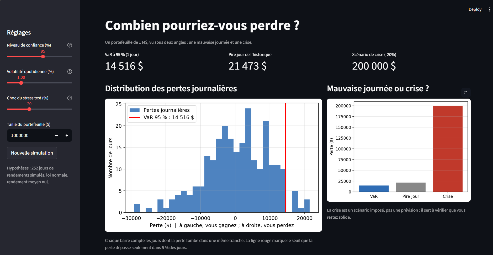
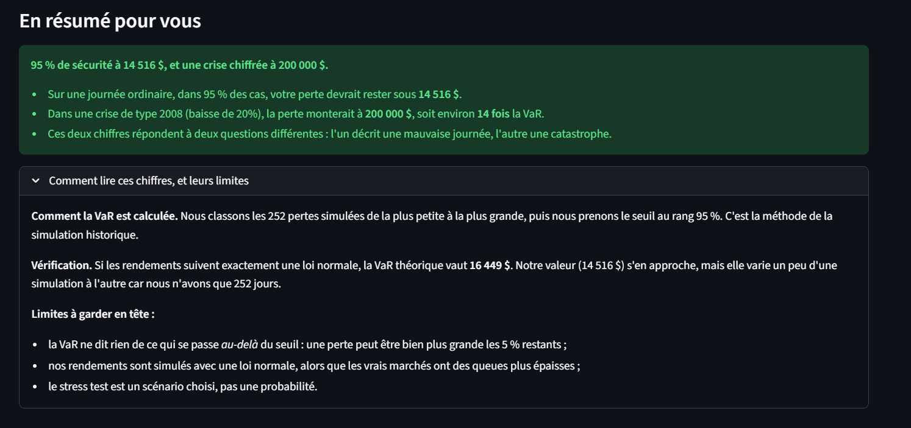

# Combien pourriez-vous perdre ? VaR et stress test d'un portefeuille de 1 M$

Un tableau de bord interactif qui répond à la question d'un client : *« Combien pourrais-je perdre sur une mauvaise journée, ou dans une crise ? »*

Vous y voyez deux chiffres pour un portefeuille de 1 M$ : la **VaR** (la perte à ne pas dépasser sur une journée ordinaire) et le **stress test** (la perte dans un scénario de crise). Les résultats se mettent à jour dès que vous bougez un curseur.





## Ce que vous pouvez faire

- Choisir le **niveau de confiance** de la VaR, de 90 % à 99 %.
- Régler la **volatilité quotidienne**, le **choc du stress test** (20 % par défaut, comme dans un scénario de type 2008) et la **taille du portefeuille**.
- Lancer une **nouvelle simulation** pour voir comment la VaR varie d'un historique à l'autre.
- Lire un **résumé rédigé pour le client**, généré à partir des chiffres affichés.

## Résultats avec les réglages par défaut

(confiance 95 %, volatilité 1 % par jour, choc de 20 %)

| VaR à 95 % (1 jour) | Pire jour de l'historique | Scénario de crise |
|:---:|:---:|:---:|
| 14 516 $ | 21 473 $ | 200 000 $ |

- Sur une journée ordinaire, dans 95 % des cas, la perte reste sous **14 516 $**.
- Dans une crise de -20 %, la perte monte à **200 000 $**, soit environ **14 fois** la VaR.
- Pour une loi normale parfaite, la VaR théorique serait de 16 449 $. Notre valeur s'en approche, mais elle varie d'une simulation à l'autre car l'historique ne compte que 252 jours.

## Méthode

1. **Données** : 252 rendements quotidiens simulés, `R_t = σ · Z_t` avec `Z_t ~ N(0,1)`, σ = 1 % et rendement moyen nul.
2. **Pertes** : `L_t = −1 M$ · R_t`. Une perte positive signifie que l'on perd de l'argent.
3. **VaR** : simulation historique. On prend le percentile à α % des pertes.
4. **Stress test** : un choc imposé au portefeuille, soit `notionnel × choc` (1 M$ × 20 % = 200 000 $). C'est un scénario, pas une prévision : il ne dépend pas des rendements simulés.

Les fonctions `simulate_returns`, `calc_var` et `stress_loss` sont séparées de l'affichage, ce qui permet de les lire et de les tester facilement.

## Lancer le projet

**Version Streamlit** (tableau de bord complet) :

```bash
pip install streamlit numpy matplotlib
streamlit run app.py
```

Le navigateur s'ouvre sur `http://localhost:8501`. Pour arrêter l'application, appuyez sur `Ctrl+C` dans le terminal.

**Version notebook** (mêmes calculs, curseurs `ipywidgets`) :

```bash
pip install numpy matplotlib ipywidgets jupyter
jupyter notebook var_dashboard.ipynb
```

Les curseurs du notebook fonctionnent en local dans Jupyter. Sur GitHub, vous voyez les résultats avec les réglages par défaut.

## Contenu du dossier

| Fichier | Rôle |
|---|---|
| `app.py` | Application Streamlit |
| `var_dashboard.ipynb` | Version notebook avec curseurs interactifs |
| `requirements.txt` | Modules Python nécessaires |
| `screenshot_*.png`, `var_dashboard.png` | Captures utilisées dans ce README |

## Limites

- Les rendements sont simulés avec une **loi normale**, alors que les vrais marchés ont des queues plus épaisses : la VaR réelle est probablement plus élevée.
- La VaR ne dit **rien de ce qui se passe au-delà du seuil** : les 5 % de jours restants peuvent être bien pires. L'Expected Shortfall répond à cette limite.
- Avec **252 jours**, la VaR historique est bruitée.
- Le stress test est un **scénario choisi**, pas une probabilité.

## Pistes d'amélioration

- Utiliser une loi à queues épaisses (Student) ou des rendements réels.
- Ajouter l'Expected Shortfall à côté de la VaR.
- Comparer la VaR historique à la VaR paramétrique et à la VaR Monte Carlo.
- Tester plusieurs scénarios de crise (2008, 2020) au lieu d'un seul choc.
